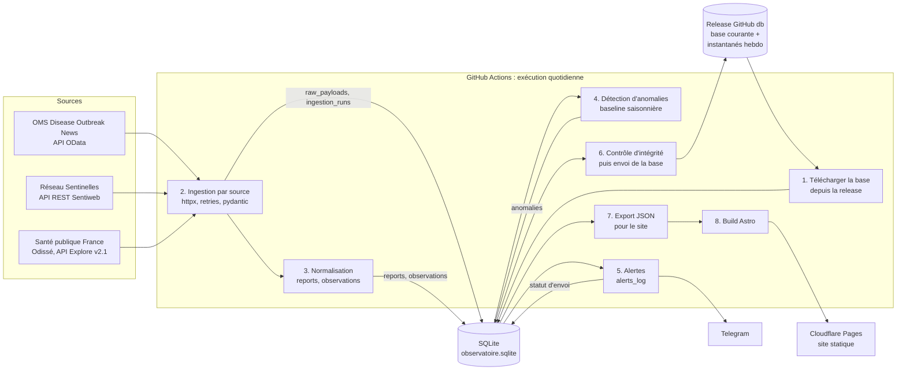

# Phase 1 : architecture

Rédigé le 2026-10-13. Ce document s'appuie sur `CONTEXTE.md` (versé au dépôt le 2026-10-14), `docs/00-sources.md` (faits vérifiés et décisions), `fixtures/who_don_sample.json` et les vérifications de la phase 1.
Fichiers liés :
- `db/schema.sql` : schéma ;
- `db/seed.sql` : sources et maladies initiales ;
- `docs/01-decisions.md` : choix, alternatives, questions ouvertes et risques ;
- `docs/01-validation.md` : exécution du schéma, requêtes et mesures, généré par `db/check_schema.py` ;
- `docs/01-invariants.md` : invariants numérotés, où ils sont appliqués, test associé ;
- `docs/01b-arbitrage.md` et `docs/01b-preuves.md` : revue du schéma et contre-exemples rejoués (`db/check_invariants.py`).

## 1. Vue d'ensemble

Principes, repris de CONTEXTE :
- aucun serveur : tout tourne dans GitHub Actions, le site est statique ;
- mise à jour quotidienne, sans « temps réel » ;
- une seule base SQLite, qui est la seule archive des révisions de données ;
- chaque chiffre affiché garde sa source, sa date et son niveau de fiabilité.

## 2. Composants

| Composant | Rôle | Technologie |
|---|---|---|
| Ingestion | Un module par source : appels HTTP, validation du format, archivage brut, normalisation, écriture en base dans une transaction | Python 3.12, httpx, pydantic v2 |
| Base | État courant et historique : rapports, séries versionnées, bruts, exécutions, anomalies, alertes | SQLite ≥ 3.39 (tables `STRICT`, `json_valid`, `IS DISTINCT FROM`) |
| Détection | Baseline saisonnière par série, sur la version courante des observations | Python (bibliothèque standard en priorité) |
| Alertes | Construction des messages, déduplication, envoi Telegram | Python, httpx, API Bot Telegram |
| Export | Fichiers JSON agrégés pour le site (pas d'accès SQLite côté Node) | Python |
| Site | Pages statiques, graphiques, carte | Astro, Observable Plot, Leaflet |
| Orchestration | Planification, secrets, publication de la base et du site | GitHub Actions |
| Hébergement | Diffusion du site | Cloudflare Pages (envoi direct par `wrangler`) |

## 3. Flux de données

### 3.1 Une exécution quotidienne

1. **Téléchargement** de `observatoire.sqlite.gz` depuis la release `db`. S'il n'existe pas (premier lancement), la base est créée à partir de `db/schema.sql` et `db/seed.sql`.
2. **Ingestion**, source par source. Chaque source ouvre une ligne `ingestion_runs` (`en_cours`), puis :
   - récupère les données (§3.2) ;
   - archive chaque contenu brut dans `raw_payloads`, sauf s'il existe déjà avec le même sha256 ;
   - OMS : si le hash reçu diffère de celui du contenu **courant** du DON, ajoute une version dans `report_versions`, même pour un retour à un contenu déjà archivé (D26) ;
   - Odissé : relit la licence de chaque jeu suivi dans le catalogue et met à jour `datasets` (D27) ;
   - valide le format (modèle pydantic et empreinte de la liste des champs, `field_fingerprint`) ;
   - écrit les rapports ou observations ;
   - ferme la ligne `ingestion_runs` avec le statut et les compteurs.

   Tout cela tient dans **une transaction par source** : un échec annule les écritures de cette source, sauf la ligne d'exécution, qui est réécrite en `echec`. Les autres sources continuent.
3. **Normalisation** (dans l'étape précédente) :
   - OMS : une ligne `reports` par `Id`, mise à jour si le contenu brut a changé ; chiffres extraits dans `report_figures`, rattachés à la version brute lue (phase 3, D23) ;
   - France : une ligne `observations` par point et par version, créée seulement si un champ versionné change : valeur, bornes ou statut de la valeur (§3.3, I50).
4. **Détection d'anomalies** sur les versions courantes des séries actives. Une ligne `anomalies` par version d'observation évaluée qui dépasse le seuil.
5. **Alertes**, livrées « au moins une fois » (D19) :
   - les nouvelles anomalies, les nouveaux DON, les DON retirés et les incidents de source (§7) créent des lignes `alerts_log` (`a_envoyer`) dans la même transaction que l'événement ;
   - envoi Telegram, puis statut `envoyee` (réponse `ok` de Telegram) ou `echec` ;
   - la clé `(channel, dedup_key)` empêche de renvoyer une alerte déjà marquée `envoyee` dans la base de départ. Un doublon reste possible si la base n'est pas envoyée après les alertes (risque R14).
6. **Contrôle et envoi de la base** :
   - `PRAGMA integrity_check` et `PRAGMA foreign_key_check` doivent être propres ; la vue `controle_invariants` doit être vide (`docs/01-invariants.md`) ; l'asset compressé doit rester sous 1,5 Gio (I58) ; le contrôle de relecture des bruts (D31) ne doit trouver aucun écart. Sinon la base n'est pas envoyée et une alerte part ;
   - compression gzip, puis remplacement de l'asset courant ;
   - le lundi, un instantané daté est ajouté.
7. **Export** des données nécessaires au site en JSON. Chaque valeur porte sa source, sa date de mise à jour, sa semaine ISO et son niveau de fiabilité.
8. **Build et déploiement** du site. Ces étapes ont lieu même si une source a échoué : le site affiche alors les dernières données connues, avec leur date.

### 3.2 Récupération par source

Les points d'accès et les limites sont ceux de `docs/00-sources.md`.

| Source | Appels par exécution | Détection de changement | Ce qui est archivé |
|---|---|---|---|
| OMS DON | 1 appel `$count=true&$top=0`, puis 32 pages de `$top=100` (3199 enregistrements) | `LastModified` et sha256 de chaque enregistrement | Un `raw_payloads` par DON et par contenu distinct (JSON canonique : clés triées, UTF-8) |
| Sentinelles | 1 appel `/version`, puis, seulement si la version a changé, 8 appels `incidence` (4 indicateurs × `PAY` et `RDD`) | Identifiant `/version` (stocké dans `ingestion_runs.source_version`) | Une réponse par appel. Budget : 9 requêtes, sous le quota de 15 par 600 s |
| Odissé | 1 appel au catalogue (métadonnées des jeux suivis), puis 1 export CSV par jeu modifié | `metas.default.data_processed` ; contrôle de la licence (doit rester « Licence ouverte 2.0 ») | Un export par jeu et par contenu distinct, compressé (`body_gzip`) |

Pour l'OMS, le parcours complet quotidien permet de vérifier l'**écart 0** à chaque exécution complète (D24). L'écart est mesuré sur les DON présents dans l'API au moment de l'exécution : `seen_count` = `expected_count` (`@odata.count`, I7) = nombre de DON de la base vus par cette exécution (`last_seen_run_id`, I9). Les DON de la base absents de l'API n'entrent pas dans l'écart. Ils sont suivis à part (vue `reports_presence`, I10) et comptés dans `ingestion_runs` (`absent_count`, `removed_count`, `reappeared_count`). La phase 1 demandait aussi `seen_count` = nombre de `reports_active`. Cette règle était fausse pendant les 3 exécutions qui précèdent le retrait d'un DON (CE-A1).

Points restant à vérifier en phase 2 :
- pagination OMS stable avec une clé de tri secondaire : 733 enregistrements partagent un horodatage ;
- profondeur de révision chez Sentinelles (`span=short` couvre 10 semaines).

### 3.3 Révisions des données

Les séries de Santé publique France et de Sentinelles sont révisées après publication. Le modèle :
- `observations` ne contient que des ajouts. Une valeur qui change crée la version `n + 1` et ferme la version `n` (`valid_to`).
- La **version courante** est celle où `valid_to IS NULL`. Un index unique partiel interdit d'en avoir deux ; la vue `controle_invariants` vérifie qu'il y en a toujours une, que les versions se suivent sans trou ni chevauchement et que `valid_from` est le début de l'exécution qui a vu la version (I20 à I25).
- La **valeur connue à une date D** (« vintage ») est celle où `valid_from <= D` et (`valid_to IS NULL` ou `valid_to > D`). Elle permet un backtest honnête à partir des données que nous aurons collectées nous-mêmes (voir le risque R1 dans `docs/01-decisions.md`).
- Une valeur retirée par la source donne une nouvelle version avec `value = NULL` et son motif dans `value_status` (D28).
- Une révision des seules bornes, ou du statut (`provisoire` → `publiee`), crée aussi une version ; une republication identique n'en crée pas (I50).

Pour les rapports OMS, on garde l'état courant dans `reports` et l'historique dans `raw_payloads`. Un DON modifié (par exemple `2022-DON398_1`, `LastModified` = 2026-10-06) produit un nouveau brut, et `reports` est mis à jour. Un DON absent de l'API n'est pas supprimé :
- il est « absent » après 1 ou 2 exécutions complètes (`succes` ou `inchange`) sans lui ;
- il est « retiré » à la 3e, et `removed_run_id` désigne cette exécution ;
- une exécution partielle ne compte pas ;
- un DON qui réapparaît redevient présent.

Voir la vue `reports_presence` et D24.

### 3.4 Correction d'un constat de la phase 0 (dates OMS)

La phase 0 concluait que la date de publication de l'API était peu fiable avant 2023. C'est vrai pour le champ `PublicationDate`, mais l'API contient un autre champ, `PublicationDateAndTime`, qui donne la bonne date. Constat sur les 3199 enregistrements récupérés le 2026-10-13 :
- `PublicationDateAndTime` se répartit de façon cohérente de 1996 à 2026, avec 75 DON en 2020 ;
- `PublicationDate` diffère de plus de 2 jours pour 1360 enregistrements, surtout à cause des migrations de juin 2021 et mars 2024 ;
- par rapport à `PublicationDateAndTime`, l'année du `DonId` ne diffère que pour 11 enregistrements, contre 442 avec `PublicationDate`. L'année en tête de titre ne diffère que pour 2 enregistrements.

Ces 13 cas sont des erreurs de `DonId` ou de date côté OMS. Ils seront marqués `date_quality = 'a_verifier'`.
Décision : `reports.published_at` = `PublicationDateAndTime`. Le titre affiché suit la règle vérifiée sur who.int : `OverrideTitle` si `UseOverrideTitle` est vrai et `OverrideTitle` non vide, sinon `Title`. Les deux pages testées (`2006DON090`, `2023-DON484`) affichent ce titre dans leur `<h1>`.

## 4. Rôle de GitHub Actions

| Workflow | Déclencheur | Contenu |
|---|---|---|
| `donnees.yml` | `schedule` quotidien à **05:47 UTC** (pas en début d'heure, voir ci-dessous), plus `workflow_dispatch` pour une relance manuelle | Étapes 1 à 8 du §3.1 |
| `ci.yml` | `push` et `pull_request` | pytest (sans réseau, sur fixtures), application de `db/schema.sql` sur une base vide, `db/check_schema.py`, build Astro |

Réglages :
- `concurrency: { group: donnees, cancel-in-progress: false }` : deux exécutions ne modifient jamais la base en même temps ; la seconde attend.
- `permissions: contents: write` pour `donnees.yml` (envoi d'assets de release avec `GITHUB_TOKEN`) ; lecture seule pour `ci.yml`.
- Secrets : `CLOUDFLARE_API_TOKEN`, `CLOUDFLARE_ACCOUNT_ID`, `TELEGRAM_BOT_TOKEN`, `TELEGRAM_CHAT_ID`. Aucun secret ni donnée personnelle dans la base.
- Version de Python : 3.12 (stack imposée). Le poste local a Python 3.14 ; la CI doit fixer 3.12.

Faits vérifiés dans la documentation GitHub le 2026-10-13 :
- Un `schedule` peut être retardé en période de forte charge, notamment en début d'heure, et des exécutions peuvent être abandonnées. D'où l'horaire décalé et la tolérance à une journée manquée.
- **Dans un dépôt public, les workflows planifiés sont désactivés après 60 jours sans activité sur le dépôt.** Le dépôt `Trinita1983/virus-101` est public. Avec la base stockée en release, aucun commit n'est automatique : il faut une parade (risque R3).

## 5. Stockage de la base

### 5.1 Volume mesuré

Le volume a été mesuré sur une base synthétique au périmètre v1 estimé (détail dans `docs/01-validation.md` §5) :

| Mesure | Valeur |
|---|---|
| Lignes `observations` | 496 770 |
| Fichier SQLite | **86,7 Mo** (82,2 Mo avant la phase 1b : `value_status`, `report_versions`, `datasets`) |
| Compressé (gzip) | 10,5 Mo (optimiste : valeurs synthétiques très régulières) |

Exports bruts Sentinelles et Odissé non inclus : leur volume réel n'est pas mesuré (R16, D29).

Limites GitHub vérifiées le 2026-10-13 :
- dans un dépôt : avertissement à 50 MiB par fichier, **blocage à 100 MiB** ; dépôt idéalement sous 1 Go, fortement recommandé sous 5 Go ; « Git is not designed to handle large SQL files » ;
- dans une release : chaque fichier doit faire **moins de 2 GiB**, 1000 assets maximum par release, aucune limite sur la taille totale ni sur la bande passante.

### 5.2 Options

| Option | Pour | Contre |
|---|---|---|
| **A. Fichier `.sqlite` commité dans le dépôt** | Le plus simple ; historique complet par `git log` ; le dépôt est l'unique artefact | 82 Mo dépasse déjà l'avertissement GitHub, et la croissance mènera au blocage à 100 MiB. Chaque commit quotidien ajoute une copie binaire mal compressée par Git, donc l'historique gonfle vite et se mesure en Go. Clones lents |
| A'. Fichier compressé `.sqlite.gz` commité | ~10-25 Mo par commit, sous les limites | Une copie complète par jour dans l'historique (365 × 10-25 Mo par an) : dépasse la recommandation de 1 Go en moins d'un an |
| **B. Asset de release (retenu)** | Hors historique Git ; jusqu'à 2 GiB par fichier ; pas de limite de taille totale ; téléchargement public direct ; instantanés datés faciles | Pas d'historique automatique (il faut des instantanés) ; remplacement d'asset non atomique ; aucun commit, donc risque de désactivation du `schedule` après 60 jours (R3) ; dépend de l'API des releases |
| C. Artefacts ou cache GitHub Actions | Intégré à Actions | Durée de conservation limitée : non durable, ne convient pas à la seule archive des révisions. Non revérifié en phase 1, écarté sur ce principe |
| D. Base hébergée (PostgreSQL gratuit) | Requêtes à distance, migration directe | Contraire à « zéro serveur » ; dépendance à un fournisseur ; identifiants à gérer |

### 5.3 Choix : option B

- Release `db` (une seule, avec le tag `db`) contenant :
  - `observatoire.sqlite.gz` : base courante, remplacée à chaque exécution ;
  - `observatoire-AAAA-Sss.sqlite.gz` : un instantané par semaine ISO, gardé sans limite. Avec 1000 assets maximum, cela fait environ 19 ans ;
  - `observatoire-jour-N.sqlite.gz` (N = 1 à 7) : un instantané quotidien tournant, pour ne pas perdre les révisions de la semaine si l'asset courant est perdu (D29, R5).
- Avant chaque envoi : `integrity_check`, `foreign_key_check`, `controle_invariants` et taille de l'asset (I58). En cas d'échec, l'envoi est annulé : on préfère garder la version de la veille. Après une purge de bruts : `VACUUM`.
- Mode de journal SQLite par défaut (`DELETE`), pas `WAL`, pour que la base tienne en un seul fichier à copier.
- La base est **publique**. Elle ne contient aucune donnée personnelle (pas d'abonnés, pas d'identifiant Telegram). Les bruts redistribuent des contenus OMS et Sentinelles : la release doit contenir un fichier de mentions (voir R6).
- Parade aux 60 jours d'inactivité : un commit hebdomadaire de `data/etat.json` (dernière exécution, compteurs par source, semaine des dernières données). C'est aussi une trace lisible dans Git. Qu'un commit du bot compte comme activité reste **à vérifier** (R3).

## 6. Portabilité vers PostgreSQL

Le schéma utilise un sous-ensemble commun aux deux moteurs. Le portage n'a **pas été testé** sur un vrai PostgreSQL : aucun n'est installé sur ce poste. La liste ci-dessous vient de l'analyse du schéma.

| # | SQLite (`db/schema.sql`) | PostgreSQL | Effet |
|---|---|---|---|
| 1 | `STRICT` en fin de `CREATE TABLE` | À supprimer (PostgreSQL est typé strictement) | Mécanique |
| 2 | `INTEGER PRIMARY KEY` (alias de rowid) ; colonnes `INTEGER` qui y font référence | `BIGINT GENERATED ALWAYS AS IDENTITY PRIMARY KEY` ; **toutes les colonnes de référence en `BIGINT`** (`run_id`, `series_id`, `raw_payload_id`…) | Mécanique, à ne pas oublier (constat 14) |
| 3 | Horodatages `TEXT` `'YYYY-MM-DDTHH:MM:SSZ'` et `CHECK (x IS strftime('%Y-%m-%dT%H:%M:%SZ', x))` | `TIMESTAMPTZ`, sans le `CHECK` (le type valide la date) | Mécanique ; les comparaisons de texte ISO deviennent des comparaisons de dates |
| 4 | Dates `TEXT` `'YYYY-MM-DD'` et `CHECK (x IS date(x))` | `DATE`, sans le `CHECK` | Mécanique |
| 4b | `CHECK` du calendrier ISO (I33) : `strftime('%w')`, `date(…, '+6 days')`, année et quantième du jeudi | `CHECK` réécrit : `EXTRACT(ISODOW FROM period_start) = 1`, `period_end = period_start + 6`, `EXTRACT(ISOYEAR …) = iso_year`, `EXTRACT(WEEK …) = iso_week` | À réécrire et à retester |
| 4c | `REAL` (8 octets, double précision) | `DOUBLE PRECISION`, **pas** `REAL` (4 octets en PostgreSQL) | Perte de précision si mal converti (constat 14) |
| 5 | Booléens `INTEGER` 0/1 avec `CHECK (x IN (0, 1))` | `BOOLEAN` ; les `= 1` deviennent `= TRUE` (index partiel `WHERE is_primary = 1` compris) | Mécanique |
| 6 | `BLOB` (`raw_payloads.body_gzip`) | `BYTEA` | Mécanique |
| 7 | JSON dans `TEXT` : `anomalies.parameters` (`CHECK (json_valid(parameters))`) et `raw_payloads.body_text` ; `json_extract()` | `anomalies.parameters` en `JSONB` (sans le `CHECK`) ; `raw_payloads.body_text` **reste `TEXT`**, car il contient aussi du CSV ; opérateurs `->>` | Requêtes de diagnostic à réécrire |
| 8 | `PRAGMA foreign_keys = ON` obligatoire à chaque connexion | Clés étrangères toujours actives | À supprimer |
| 9 | `PRAGMA user_version = 1` | Table de migrations | À remplacer |
| 10 | `LIKE` insensible à la casse (ASCII) | `LIKE` sensible à la casse | Aucun usage dépendant de la casse dans le schéma |
| 11 | `group_concat()` (requêtes de validation) | `string_agg()` | Requêtes à réécrire |
| 12 | `INSERT ... ON CONFLICT (...) DO NOTHING`, `RETURNING`, index uniques partiels, vues, fonctions de fenêtre, clés étrangères composites, index unique sur expression (`COALESCE`), `IS [NOT] DISTINCT FROM`, `LIMIT ... OFFSET` dans une sous-requête | Identiques | Aucun (non testé sur un vrai PostgreSQL) |
| 13 | Valeurs énumérées en `CHECK (... IN (...))` | Identiques (pas de type `ENUM`, volontairement) | Aucun |

Règle de code pour rester portable : **aucune fonction de date SQL dans les requêtes** (`strftime`, `date('now', ...)`). Les bornes de dates sont calculées en Python et passées en paramètres, comme dans `docs/01-validation.md` §4.3. Les fonctions de date ne figurent que dans les `CHECK` de validation (lignes 3, 4 et 4b ; D15).

## 7. Gestion des pannes de source

| Situation | Détection | Réaction | Ce que voit le public |
|---|---|---|---|
| Délai dépassé, erreur réseau, HTTP 5xx | Exception httpx, code HTTP | 3 nouvelles tentatives avec attente croissante (2 s, 8 s, 30 s, plus une part aléatoire). Ensuite : `ingestion_runs.status = 'echec'`, `error_kind = 'reseau'` ou `'http'` ; alerte `source_en_echec` | Dernières données connues, avec leur date |
| HTTP 429 (quota, Sentinelles) | Code 429, en-têtes `X-RateLimit-Reset` et `Retry-After` | Pas de nouvel essai dans l'exécution (risque de blocage d'IP de plusieurs jours) ; `error_kind = 'quota'` ; nouvel essai le lendemain | Idem |
| Autre HTTP 4xx (URL ou paramètre changé) | Code HTTP | Échec immédiat sans nouvel essai ; alerte `format_modifie` | Idem |
| Format changé (champ manquant, type différent, nouveaux champs) | Échec de validation pydantic, ou `field_fingerprint` différent de la dernière exécution réussie | Transaction annulée pour cette source ; alerte `format_modifie`. Les nouveaux champs seuls donnent un avertissement, pas un échec | Idem |
| Comptage incohérent (OMS : `seen_count ≠ expected_count`, `Id` reçus en double, ou baisse de plus de 1 % du total) | Contrôle après la pagination | Exécution `partiel` (`error_kind = 'controle'`), qui ne compte pas pour le retrait d'un DON (D24) ; les DON reçus sont mis à jour ; alerte `ecart_comptage` | Idem |
| Source joignable mais pas mise à jour | Pas de nouvelle donnée depuis plus de `sources.max_staleness_days` (OMS 45 j, Sentinelles 14 j, Odissé 14 j) | Alerte `donnees_perimees` (une par jour maximum, via `dedup_key`) | Badge « données de la semaine X » qui rend le retard visible |
| Licence d'un jeu Odissé modifiée | `metas.default.license` différente de « Licence ouverte 2.0 » | `datasets.is_publishable = 0` et `not_publishable_since` renseigné, preuve archivée ; le jeu n'est plus ingéré ; alerte `format_modifie`. Les observations déjà collectées restent publiées (D30) ; toute collecte postérieure bloque l'envoi (I54) | Le jeu n'est plus mis à jour ; ses données portent la mention « collectées sous Licence Ouverte 2.0 jusqu'au … » |
| Base téléchargée corrompue | `integrity_check` | Arrêt avant ingestion ; restauration manuelle depuis le dernier instantané | Site inchangé |
| Le workflow entier échoue ou ne tourne plus | Étape `if: failure()` qui envoie un message Telegram ; notification GitHub par e-mail (comportement par défaut, non vérifié) | Relance manuelle (`workflow_dispatch`) | La date de mise à jour affichée vieillit |

Un arrêt complet (workflow désactivé, panne de GitHub) n'est détecté par aucun de ces mécanismes, puisqu'ils tournent dans le workflow lui-même. Il faut un contrôle externe (question Q4 dans `docs/01-decisions.md`).

## 8. Limites connues du site (Cloudflare Pages, offre gratuite)

Limites issues de la phase 0 :
- 20 000 fichiers par site : une page par DON représenterait 3199 fichiers, ce qui reste compatible, mais la structure des pages sera à dimensionner en phase 4 ;
- 25 MiB par fichier : les exports JSON doivent rester agrégés ;
- 500 builds par mois : avec une publication par jour, on en fait environ 31.

Non vérifié : si un envoi direct par `wrangler` compte comme un build. Même si c'est le cas, on reste très en dessous de la limite.
